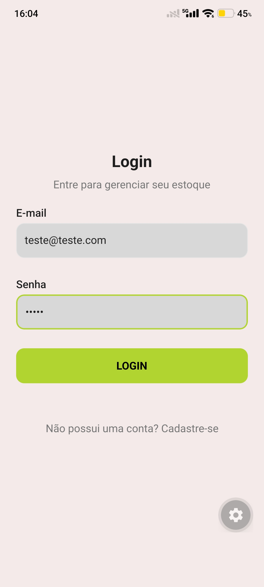
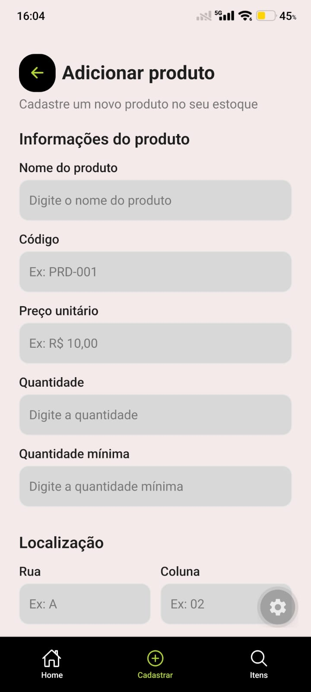

# Estoque Fácil

## Descrição
Aplicativo mobile para gerenciamento inteligente de estoque voltado a
pequenos e médios comerciantes, permitindo cadastrar, buscar e localizar
produtos fisicamente no estoque (rua, coluna, vão e nível). O aplicativo se
comunica com um backend próprio (API REST), que guarda os dados em um banco
relacional.

## Problema que a aplicação resolve
Pequenos e médios comércios muitas vezes não têm controle preciso sobre a
quantidade e a localização dos produtos em estoque, o que gera perda de
tempo na busca de itens e falta de visibilidade para o lojista.

## Tecnologias utilizadas
- **Mobile:** React Native (Expo) + TypeScript
- **Navegação:** Expo Router (rotas baseadas em arquivos, `Stack` + `Tabs` inferiores)
- **Tipografia:** Poppins
- **Backend:** Java + Spring Boot (Spring Web, Spring Data JPA, Bean Validation, Lombok)
- **Banco de dados:** PostgreSQL (relacional), acessado via JPA/Hibernate
- **Comunicação app ↔ backend:** API REST em JSON, via `fetch`
- **Serviço externo (Etapa 6):** Open Products Facts e Open Food Facts, para consultar produtos pelo código de barras (sem chave de acesso)
- **Persistência local (prevista):** SQLite / AsyncStorage — na Etapa 5 os dados passaram a ser guardados no servidor, que é a fonte única da verdade

**Uso de IA:** o assistente Claude (Anthropic) foi usado como apoio na
integração entre app e API, na depuração e na redação da documentação. O
código foi revisado e testado pelo autor.

## Estrutura do repositório

```text
EstoqueFacil/
├── README.md
├── docs/                          # proposta e documentação de cada etapa
└── src/
    ├── back-end/EstoqueFacil/     # API Spring Boot
    │   └── src/main/java/dev/Kaeliton/EstoqueFacil/
    │       ├── Address/           # endereço físico (embeddable)
    │       ├── Category/          # model, repository, service e controller
    │       └── Products/          # model, repository, service e controller
    └── front-end/EstoqueFacil/    # aplicativo React Native (Expo)
        └── src/
            ├── app/               # telas e rotas
            ├── components/        # componentes reutilizáveis
            ├── context/           # ProductsContext (estado global)
            ├── hooks/             # useBarcodeLookup (consulta ao serviço externo)
            ├── services/          # comunicação com a API
            └── types/
```

## Navegação

A navegação é feita com o Expo Router. O `Stack` principal direciona o
usuário para a tela de Login e, após o acesso, para o grupo de abas inferiores.

```text
src/app/
├── _layout.tsx        # Stack principal
├── index.tsx          # Redireciona para o Login
├── login.tsx
├── produto/[id].tsx   # Detalhe do produto (ajuste de quantidade e exclusão)
└── (tabs)/
    ├── _layout.tsx    # Barra de navegação inferior (Tabs)
    ├── index.tsx      # Home / Dashboard
    ├── search.tsx     # Itens / Busca
    └── add.tsx        # Cadastrar produto
```

```text
Aplicação → Login → Área principal ┬─ Home
                                   ├─ Itens ── Detalhe do produto
                                   └─ Cadastrar
```

| Aba       | Função                         |
| --------- | ------------------------------ |
| Home      | Visualizar o resumo do estoque |
| Itens     | Buscar e consultar produtos    |
| Cadastrar | Cadastrar um novo produto      |

> Na Etapa 03, a aba **Menu** foi removida por não possuir funcionalidades
> suficientes que justificassem uma área própria. Ela poderá ser
> reintroduzida caso sejam implementadas configurações, perfil ou outras
> opções administrativas.

## Arquitetura da integração (Etapa 5)

```text
Telas  →  ProductsContext  →  services/ (api, productService, categoryService)  →  API Spring Boot  →  PostgreSQL
```

- **Telas** só usam o hook `useProducts()`; não conhecem URLs nem `fetch`.
- **`ProductsContext`** mantém o estado global e converte os dados entre o formato do app e o da API (`toProduct` / `toPayload`).
- **`services/`** concentra todas as chamadas HTTP.
- **Backend** valida os dados (Bean Validation) e persiste com JPA.

### Endpoints da API

| Recurso | Método e rota |
| --- | --- |
| Categorias | `GET /category/list`, `GET /category/list/names`, `POST /category/create`, `DELETE /category/delete/{id}` |
| Produtos | `GET /products/list`, `GET /products/list/last-ten`, `GET /products/{id}`, `POST /products/create`, `POST /products/update/{id}`, `DELETE /products/delete/{id}` |
| Buscas | `GET /products/category/{categoryId}`, `GET /products/name/{name}`, `GET /products/barcode/{barcode}` |

### Serviço externo (Etapa 6)

Na tela **Cadastrar**, o usuário informa o código de barras e toca em **Buscar dados do produto**. O app consulta o Open Products Facts (e, se não encontrar, o Open Food Facts) e preenche o nome do produto.

```text
add.tsx → useBarcodeLookup → openProductsFactsService → GET world.openproductsfacts.org/api/v2/product/{codigo}.json
                                                      └→ (se não achar) GET world.openfoodfacts.org/api/v2/product/{codigo}.json
```

A consulta é feita direto do aplicativo, pois a leitura não exige chave nem token. Detalhes (endpoints, formato dos dados, estados e testes) em [`docs/etapa-06.md`](docs/etapa-06.md).

> O campo `code` do produto passou a ser **texto** (`String`), porque códigos de barras EAN-13 não cabem em `int` e podem começar com zero. Em um banco já existente, converta a coluna (veja a seção abaixo).

## UX e acessibilidade

**Feedback visual**
- Botões: estados normal, pressionado, desabilitado e carregamento (quando aplicável)
- Campos de entrada: estados normal, focado, erro (com mensagem textual) e desabilitado
- Filtros: estados normal, pressionado e selecionado
- Indicador de carregamento enquanto os dados são buscados no servidor

**Componentes reutilizáveis:** `PrimaryButton`, `InputField`, `FilterButton`,
`SearchInput`, `BackButton` e `ProductListItem`, garantindo comportamento e
aparência consistentes entre as telas.

**Acessibilidade**
- `accessibilityRole`, `accessibilityLabel` e `accessibilityState` nos botões, campos e filtros
- Campos com label, indicação de estado desabilitado e identificação de erro
- `BackButton` com identificação específica para leitores de tela
- Informações importantes não dependem apenas de cor (uso de mensagens textuais)
- Tipografia e espaçamentos centralizados no sistema de tema da aplicação
- Áreas de toque dimensionadas para uso em dispositivos móveis

## Capturas de tela

| Login | Cadastro de Produto |
|---|---|
|  |  |

> Salve as imagens em `docs/screenshots/` com esses nomes (ou ajuste os caminhos acima) para as imagens aparecerem no README.

## Instruções para execução

Para o fluxo completo é preciso rodar o **backend** e o **aplicativo**.

### Pré-requisitos
- JDK compatível com o `pom.xml` (Maven ou o `mvnw` do projeto)
- PostgreSQL em execução com um banco criado para o projeto
- Node.js e npm
- Expo Go no celular, ou um emulador Android

### 1. Backend

```bash
cd src/back-end/EstoqueFacil
# copie o .env.example para .env e preencha as credenciais do banco
./mvnw spring-boot:run
```

A API sobe em `http://localhost:8080`. As tabelas `category` e `product` são
criadas automaticamente pelo Hibernate na primeira execução.

### 2. Aplicativo

```bash
cd src/front-end/EstoqueFacil
npm install
# copie o .env.example para .env e ajuste EXPO_PUBLIC_API_URL
npx expo start
```

`EXPO_PUBLIC_API_URL` depende de onde o app roda:

| Onde roda | Valor |
| --- | --- |
| Emulador Android | `http://10.0.2.2:8080` |
| Simulador iOS | `http://localhost:8080` |
| Celular físico (Expo Go) | `http://IP_DO_PC:8080` (mesma rede Wi-Fi) |

Com o Expo em execução, é possível abrir a aplicação:
- no **Expo Go**, escaneando o QR code em um dispositivo Android;
- em um **emulador Android**, pressionando `a` no terminal;
- no **navegador**, pressionando `w` no terminal (quando suportado).

Depois de alterar o `.env` ou em caso de problemas após alterações nos
arquivos, reinicie limpando o cache:

```bash
npx expo start -c
```

> No Windows, se o PowerShell bloquear o `npm`, rode uma vez
> `Set-ExecutionPolicy -Scope CurrentUser -ExecutionPolicy RemoteSigned`
> ou use o Prompt de Comando (cmd).

### Testando o fluxo completo (Etapa 5)

1. Suba o backend e o aplicativo.
2. Inicie a aplicação, passe pelo Login (fluxo de demonstração) e acesse a Home.
3. Cadastre uma categoria e, na aba **Cadastrar**, um produto com quantidade, quantidade mínima, preço e localização.
4. Confira o produto na aba **Itens** e na Home (valor total e itens que precisam de reposição).
5. Abra o produto e registre uma entrada ou baixa de estoque.
6. Exclua o produto e confirme que ele sumiu da lista.
7. Teste entradas inválidas (campos vazios, valores negativos) e confira as mensagens de erro.

O roteiro detalhado, com exemplos para testar a API no Postman, está em
[`docs/etapa-05.md`](docs/etapa-05.md).

### Testando a integração com o serviço externo (Etapa 6)

Requer internet no aparelho ou emulador.

1. Abra a aba **Cadastrar**, digite `737628064502` no código de barras e toque em **Buscar dados do produto**. O nome deve ser preenchido.
2. Confira o produto, escolha a categoria, preencha o restante e cadastre.
3. Estados: um código inventado (ex.: `1234567890123`) mostra "não encontrado"; com o modo avião ligado aparece o erro de conexão; um código com menos de 8 dígitos mostra o erro de validação; durante a consulta o botão exibe o carregamento.
4. Cadastrar o mesmo código duas vezes é recusado.

**Banco já existente:** como `code` virou texto, rode uma vez (PostgreSQL) `ALTER TABLE product ALTER COLUMN code TYPE varchar(20) USING code::varchar;` ou apague a tabela `product` em desenvolvimento. Em um banco novo o Hibernate já cria a coluna correta.

### Testando a navegação e a acessibilidade

1. Inicie a aplicação e verifique o direcionamento para a tela de Login.
2. Preencha e-mail e senha e pressione o botão de Login (fluxo de demonstração).
3. Confirme o acesso à Home e navegue pelas abas **Itens** e **Cadastrar**.
4. Na aba Itens, utilize o campo de busca e os filtros.
5. Na aba Cadastrar, teste os campos de entrada e seus estados visuais.
6. Ative o leitor de tela do dispositivo (no Android, o **TalkBack**) e verifique
   se os elementos interativos possuem identificação e descrição adequadas.

## Funcionalidades implementadas

- [x] Login — interface implementada (e-mail, senha, "esqueceu a senha?", cadastro); **sem autenticação real ainda**
- [x] Dashboard (Home) — visão geral do estoque (itens cadastrados, itens com estoque baixo, valor total, gráfico por categoria e seção de produtos), agora com **dados reais vindos da API**
- [x] Cadastro de produto — informações do produto, localização e categoria, **salvos no banco via API**
- [x] Cadastro de categorias — criação e listagem de categorias via API
- [x] Listagem/busca de produtos — campo de busca, filtros e lista com código e quantidade em estoque, com dados reais
- [x] Alteração de estoque — entrada e baixa de quantidade, sem permitir valor negativo
- [x] Exclusão de produtos
- [x] Endereçamento físico do produto (rua, coluna, vão, nível) — salvo e exibido nas telas
- [x] **Fluxo completo de negócio (Etapa 5):** criar → visualizar → alterar → excluir produto
- [x] **Integração com serviço externo (Etapa 6):** consulta de produto por código de barras (Open Products Facts / Open Food Facts), com estados de carregamento, sucesso, erro e ausência de dados
- [x] Código de barras salvo como texto, com bloqueio de código duplicado no backend
- [x] Backend REST com Spring Boot, JPA e PostgreSQL
- [x] Validação de dados no backend (`@NotBlank`, `@NotNull`, `@PositiveOrZero`) e tratamento de entradas inválidas no app
- [x] Navegação por abas (Home, Itens, Cadastrar) com fluxo Login → área principal
- [x] Feedback visual nos principais componentes (botões, campos de entrada, filtros e indicador de carregamento)
- [x] Medidas iniciais de acessibilidade (papéis, rótulos e estados para leitores de tela)
- [ ] Autenticação real (login com backend)
- [ ] Leitura de código de barras via câmera

## Limitações conhecidas
- Etapa 01: apenas planejamento e documentação da proposta, sem código
  funcional ainda.
- Etapa 02: implementada a camada visual e de navegação (Login, Dashboard,
  Cadastro de Produto e Consulta de Produtos), com dados mockados.
- Etapa 03: navegação refinada, com feedback visual e acessibilidade nos
  principais componentes. O Menu foi removido por falta de funcionalidades.
- Etapa 05 (atual):
  - O Login continua sendo apenas de demonstração: não há autenticação nem controle de usuários.
  - O app precisa de conexão com o servidor; não há uso offline nem cache local.
  - Em desenvolvimento a comunicação usa HTTP sem criptografia; em produção deve ser HTTPS.
  - A API expõe as entidades diretamente, sem DTOs, e a atualização de produto usa `POST` em vez de `PUT`/`PATCH`.
  - Sem paginação nas listagens.
  - A leitura de código de barras pela câmera ainda não foi implementada.
  - Sem testes automatizados.
- Etapa 06:
  - Os serviços usados são bases colaborativas: a cobertura de produtos (principalmente não alimentícios e marcas locais) é incompleta, e os dados devem ser conferidos pelo usuário.
  - A consulta preenche apenas o nome (e marca); categoria, quantidade, preço e localização continuam manuais.
  - A consulta depende de internet e de o serviço público estar no ar; se falhar, o cadastro manual continua disponível.
  - A leitura do código pela câmera ainda não foi implementada (o código é digitado).

## Documentação
- [Proposta da aplicação](docs/proposta.md)
- [Etapa 02 — Implementação do protótipo de interface](docs/etapa-02.md)
- [Etapa 03 — Navegação, UX e Acessibilidade](docs/etapa-03.md)
- [Etapa 05 — Primeira versão funcional com backend](docs/etapa-05.md)
- [Etapa 06 — Integração com serviço externo](docs/etapa-06.md)