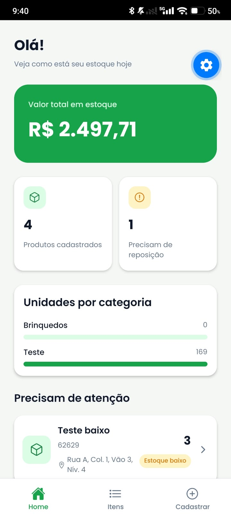
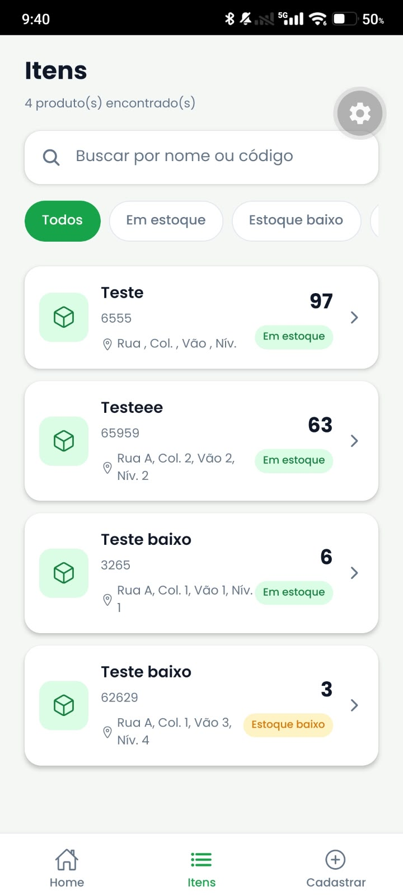

# Estoque Fácil

Aplicativo mobile para gerenciamento de estoque de pequenos e médios comerciantes, com cadastro de produtos e categorias, consulta de quantidades, localização física dos itens e controle de movimentações de estoque. A aplicação utiliza uma API REST desenvolvida em Java com Spring Boot e persiste os dados em um banco de dados PostgreSQL.

## Descrição

O Estoque Fácil tem como objetivo simplificar o controle de mercadorias, permitindo que o comerciante consulte informações sobre seus produtos, acompanhe o nível de estoque e identifique a localização física dos itens por meio de rua, coluna, vão e nível.

O projeto foi desenvolvido em etapas, começando pelo planejamento e protótipo da interface mobile até chegar à primeira versão funcional integrada a um backend próprio.

## Problema que a aplicação resolve

Pequenos e médios comércios muitas vezes não possuem ferramentas adequadas para controlar as quantidades e a localização dos produtos armazenados. Isso pode gerar perda de tempo na busca por mercadorias, dificuldade para identificar itens que precisam de reposição e falta de visibilidade sobre o valor do estoque.

O Estoque Fácil busca centralizar essas informações em uma aplicação mobile de interface simples, com persistência em banco de dados e comunicação com uma API REST.

## Tecnologias utilizadas

| Camada | Tecnologias |
|---|---|
| Aplicativo mobile | React Native, Expo e TypeScript |
| Navegação | Expo Router (`Stack` e `Tabs`) |
| Interface | Poppins e componentes reutilizáveis |
| Backend | Java e Spring Boot |
| API | Spring Web |
| Persistência | Spring Data JPA e Hibernate |
| Banco de dados | PostgreSQL |
| Validação | Jakarta Bean Validation |
| Produtividade | Lombok |
| Comunicação | API REST, JSON e `fetch` |

**Uso de inteligência artificial:** o assistente Claude, da Anthropic, foi utilizado como apoio na integração entre o aplicativo e a API, na depuração e na elaboração da documentação. O código foi revisado e testado pelo autor.

## Estrutura do repositório

```text
EstoqueFacil/
├── README.md
├── docs/
│   ├── proposta.md
│   ├── etapa-02.md
│   ├── etapa-03.md
│   ├── etapa-05.md
│   └── screenshots/
└── src/
    ├── back-end/
    │   └── EstoqueFacil/
    │       └── src/main/java/dev/Kaeliton/EstoqueFacil/
    │           ├── Address/
    │           ├── Category/
    │           └── Products/
    └── front-end/
        └── EstoqueFacil/
            └── src/
                ├── app/
                ├── components/
                ├── context/
                ├── services/
                └── types/
```

### Responsabilidades dos diretórios

- `Address/`: representação do endereço físico dos produtos.
- `Category/`: implementação das operações relacionadas às categorias, incluindo model, repository, service e controller.
- `Products/`: implementação das operações relacionadas aos produtos, incluindo model, repository, service e controller.
- `app/`: telas e rotas do aplicativo mobile.
- `components/`: componentes reutilizáveis da interface.
- `context/`: gerenciamento do estado global dos produtos.
- `services/`: comunicação HTTP com a API.
- `types/`: definições de tipos utilizadas no frontend.

## Navegação

A navegação é implementada com Expo Router. O `Stack` principal organiza as telas de acesso e os detalhes dos produtos, enquanto as abas inferiores permitem navegar pelas principais funcionalidades do aplicativo.

```text
src/app/
├── _layout.tsx
├── index.tsx
├── login.tsx
├── produto/
│   └── [id].tsx
└── (tabs)/
    ├── _layout.tsx
    ├── index.tsx
    ├── search.tsx
    └── add.tsx
```

Fluxo principal:

```text
Aplicação
    └── Login (demonstrativo)
         └── Área principal
              ├── Home
              ├── Itens
              │    └── Detalhe do produto
              └── Cadastrar
```

| Aba | Função |
|---|---|
| Home | Exibir o resumo do estoque, o valor total e os produtos que precisam de reposição. |
| Itens | Consultar, pesquisar e filtrar produtos cadastrados. |
| Cadastrar | Cadastrar produtos e informar seus dados, categoria e localização. |
| Detalhe do produto | Consultar informações, registrar entradas e baixas e excluir produtos. |

A aba **Menu** foi removida na Etapa 03 por não possuir funcionalidades suficientes para justificar uma área própria. Ela poderá ser reintroduzida futuramente, caso sejam implementadas configurações ou opções administrativas.

## Arquitetura da integração — Etapa 05

A Etapa 05 implementa a integração entre o aplicativo mobile, a API REST e o banco de dados relacional.

```text
┌─────────────────────────┐
│    Telas do aplicativo  │
│       React Native      │
└────────────┬────────────┘
             │
             ▼
┌─────────────────────────┐
│    ProductsContext      │
│   Estado global         │
└────────────┬────────────┘
             │
             ▼
┌─────────────────────────┐
│       services/         │
│  API e serviços HTTP    │
└────────────┬────────────┘
             │ JSON / HTTP
             ▼
┌─────────────────────────┐
│     API Spring Boot     │
│ Controllers / Services  │
│ Repositories / JPA      │
└────────────┬────────────┘
             │
             ▼
┌─────────────────────────┐
│       PostgreSQL        │
└─────────────────────────┘
```

### Responsabilidades das camadas

- **Telas:** apresentam os dados e permitem que o usuário execute as operações do sistema.
- **`ProductsContext`:** mantém o estado global dos produtos e centraliza a interação do frontend com os serviços.
- **`services/`:** concentra as requisições HTTP, evitando que as telas precisem conhecer diretamente as URLs da API.
- **Backend:** recebe as requisições, valida os dados, executa as regras de negócio e coordena a persistência.
- **JPA/Hibernate:** realiza o mapeamento entre as entidades Java e as tabelas do banco de dados.
- **PostgreSQL:** armazena os dados persistentes de produtos e categorias.

O estado exibido pelo aplicativo é atualizado a partir das respostas da API. Nesta etapa, o servidor é a fonte principal dos dados, sem implementação de persistência offline ou cache local.

## Endpoints da API

Os endpoints implementados para a integração estão organizados por recurso.

### Categorias

| Método | Endpoint | Operação |
|---|---|---|
| GET | `/category/list` | Listar categorias |
| GET | `/category/list/names` | Consultar nomes das categorias |
| POST | `/category/create` | Criar categoria |
| DELETE | `/category/delete/{id}` | Excluir categoria |

### Produtos

| Método | Endpoint | Operação |
|---|---|---|
| GET | `/products/list` | Listar produtos |
| GET | `/products/list/last-ten` | Consultar os dez produtos mais recentes |
| GET | `/products/{id}` | Consultar produto por ID |
| POST | `/products/create` | Cadastrar produto |
| POST | `/products/update/{id}` | Atualizar produto |
| DELETE | `/products/delete/{id}` | Excluir produto |

### Consultas específicas

| Método | Endpoint | Operação |
|---|---|---|
| GET | `/products/category/{categoryId}` | Consultar produtos por categoria |
| GET | `/products/name/{name}` | Buscar produto pelo nome |
| GET | `/products/barcode/{barcode}` | Consultar produto pelo código de barras |

**Observação:** o endpoint de consulta por código de barras está previsto na API, mas a leitura automática pela câmera do celular ainda não está implementada.

## Funcionalidades implementadas

- [x] Interface de login e cadastro de acesso demonstrativa.
- [x] Dashboard com resumo do estoque, valor total, categorias e produtos.
- [x] Cadastro de produtos com informações comerciais e localização física.
- [x] Cadastro e consulta de categorias.
- [x] Listagem, pesquisa e filtragem de produtos.
- [x] Consulta detalhada de produtos.
- [x] Registro de entrada e baixa de estoque.
- [x] Validação para impedir quantidades negativas nas movimentações.
- [x] Exclusão de produtos.
- [x] Persistência de produtos e categorias via API e PostgreSQL.
- [x] Integração entre frontend e backend.
- [x] Validação de dados no backend com Jakarta Bean Validation.
- [x] Feedback visual e indicador de carregamento nas operações aplicáveis.
- [x] Medidas iniciais de acessibilidade para leitores de tela.
- [ ] Autenticação real e controle de acesso por usuário.
- [ ] Leitura de código de barras utilizando a câmera.
- [ ] Funcionamento offline e sincronização posterior.
- [ ] Testes automatizados.

## UX e acessibilidade

### Feedback visual

A interface contempla estados visuais para orientar o usuário durante a utilização:

- Botões nos estados normal, pressionado, desabilitado e carregamento, quando aplicável.
- Campos de entrada com estados de foco, erro e desabilitado.
- Filtros com indicação de seleção.
- Mensagens textuais para comunicar erros de entrada.
- Indicadores de carregamento durante as consultas ao servidor.

### Componentes reutilizáveis

Entre os componentes utilizados estão:

- `PrimaryButton`
- `InputField`
- `FilterButton`
- `SearchInput`
- `BackButton`
- `ProductListItem`

A reutilização desses componentes ajuda a manter a consistência visual e comportamental entre as telas.

### Acessibilidade

- Uso de `accessibilityRole`, `accessibilityLabel` e `accessibilityState` nos elementos interativos aplicáveis.
- Identificação textual dos campos e de seus erros.
- Descrição específica do botão de voltar para leitores de tela.
- Informações importantes apresentadas sem depender exclusivamente de cores.
- Tipografia e espaçamentos centralizados no sistema de tema.
- Áreas de toque dimensionadas para interação em dispositivos móveis.

## Capturas de tela

As capturas podem ser armazenadas no diretório `docs/screenshots/`.

| Login | Cadastro de produto |
|---|---|
|  |  |

Caso as imagens ainda não estejam no repositório, adicione os arquivos com os nomes acima ou ajuste os caminhos para corresponder aos arquivos existentes.

## Instruções para execução

Para testar o fluxo completo, é necessário executar o backend, configurar o PostgreSQL e iniciar o aplicativo mobile.

### Pré-requisitos

- JDK compatível com o projeto.
- Maven ou Maven Wrapper (`mvnw`).
- PostgreSQL instalado e em execução.
- Node.js e npm.
- Expo Go em um dispositivo compatível ou emulador Android.
- Acesso à rede entre o dispositivo e o computador, quando utilizado um celular físico.

### 1. Configurar o banco de dados

Crie um banco de dados PostgreSQL para o projeto e configure as credenciais utilizadas pelo backend.

Consulte o arquivo de configuração da aplicação em `src/back-end/EstoqueFacil` e preencha as variáveis de ambiente previstas no projeto.

Se houver um arquivo `.env.example`, utilize-o como referência para criar o arquivo `.env` correspondente.

Não compartilhe credenciais reais nem envie arquivos `.env` com senhas para o repositório.

### 2. Executar o backend

No terminal, a partir da raiz do repositório:

```bash
cd src/back-end/EstoqueFacil
./mvnw spring-boot:run
```

No Windows, caso necessário, utilize:

```powershell
.\mvnw.cmd spring-boot:run
```

A API deverá estar disponível em:

```text
http://localhost:8080
```

Na configuração descrita para esta etapa, o Hibernate cria as tabelas das entidades durante a inicialização, conforme as propriedades definidas no projeto.

Confirme que a conexão com o PostgreSQL foi estabelecida antes de iniciar os testes pelo aplicativo.

### 3. Configurar e executar o aplicativo

Em outro terminal:

```bash
cd src/front-end/EstoqueFacil
npm install
```

Configure a variável `EXPO_PUBLIC_API_URL` no arquivo `.env` do frontend, de acordo com o ambiente de execução.

Exemplo para um emulador Android:

```env
EXPO_PUBLIC_API_URL=http://10.0.2.2:8080
```

Valores para outros ambientes:

| Ambiente | Valor de `EXPO_PUBLIC_API_URL` |
|---|---|
| Emulador Android | `http://10.0.2.2:8080` |
| Simulador iOS | `http://localhost:8080` |
| Celular físico com Expo Go | `http://IP_DO_PC:8080` |

No celular físico, substitua `IP_DO_PC` pelo endereço IPv4 do computador na rede local. O celular e o computador devem estar na mesma rede, e o firewall precisa permitir a conexão com a porta da API.

O endereço `localhost` no celular aponta para o próprio celular, não para o computador que está executando o backend.

Depois da configuração, inicie o Expo:

```bash
npx expo start
```

Para reiniciar o servidor do Expo limpando o cache:

```bash
npx expo start -c
```

Após alterar o `.env`, reinicie o Expo para que as variáveis sejam carregadas novamente.

Com o Expo em execução, você poderá:

- Abrir o aplicativo no Expo Go, escaneando o QR code.
- Pressionar `a` no terminal para abrir o emulador Android.
- Pressionar `w` para executar a versão web, quando suportada pelas dependências utilizadas.

**Importante:** as variáveis `EXPO_PUBLIC_*` são incorporadas ao aplicativo e não devem conter senhas, tokens privados ou outras credenciais.

## Testando o fluxo completo de negócio — Etapa 05

O fluxo principal implementado atende à proposta de executar uma operação de negócio do início ao fim: criar, visualizar, alterar e excluir um produto.

1. Inicie o PostgreSQL e confirme que o banco está acessível.
2. Execute o backend Spring Boot.
3. Inicie o aplicativo Expo e acesse a tela de login.
4. Utilize o fluxo de acesso demonstrativo para entrar na área principal.
5. Cadastre uma categoria, caso ainda não exista.
6. Acesse a aba **Cadastrar** e registre um produto com nome, categoria, quantidade, quantidade mínima, preço e localização física.
7. Acesse a aba **Itens** e confirme que o produto aparece na listagem.
8. Abra o detalhe do produto e confira as informações cadastradas.
9. Registre uma entrada ou baixa de estoque e verifique a quantidade atualizada.
10. Retorne à listagem e à Home para conferir os dados atualizados.
11. Exclua o produto e confirme que ele deixou de aparecer na listagem.
12. Teste entradas inválidas, como campos obrigatórios vazios e valores negativos, e verifique o tratamento de erros.

Para testar a API de forma independente do aplicativo, utilize uma ferramenta como o Postman e envie requisições aos endpoints documentados anteriormente.

O roteiro complementar, incluindo instruções de execução, testes da API e decisões técnicas, está disponível em [`docs/etapa-05.md`](docs/etapa-05.md).

### Testando a acessibilidade

1. Navegue pelas telas e verifique a identificação dos elementos interativos.
2. Teste os estados de foco, erro, desabilitado e carregamento, quando aplicáveis.
3. Ative o TalkBack no Android e confira os rótulos e as descrições dos botões, campos e filtros.
4. Verifique se as mensagens de erro e os estados importantes podem ser compreendidos sem depender apenas de cores.

## Limitações conhecidas

A versão atual representa a primeira integração funcional do aplicativo com um backend, mas ainda existem pontos que precisam ser aprimorados.

- **Autenticação:** a tela de login é demonstrativa. Não existe autenticação real no backend nem isolamento dos dados por usuário.
- **Conectividade:** o aplicativo depende da conexão com a API e não oferece funcionamento offline ou sincronização posterior.
- **Segurança de transporte:** o ambiente de desenvolvimento utiliza HTTP sem criptografia. Uma implantação pública deve utilizar HTTPS e outras medidas de segurança apropriadas.
- **Modelagem da API:** a implementação atual expõe entidades diretamente, sem uma camada de DTOs dedicada.
- **Atualização de produtos:** a operação utiliza `POST` em vez de `PUT` ou `PATCH`.
- **Paginação:** as listagens não possuem paginação implementada.
- **Código de barras:** a leitura automática pela câmera ainda não está disponível.
- **Testes automatizados:** ainda não há cobertura automatizada implementada.
- **Persistência local:** não há cache local para consulta dos dados sem conexão com o servidor.

## Histórico de desenvolvimento

### Etapa 01 — Planejamento

Definição da proposta da aplicação, do problema a ser resolvido e das funcionalidades previstas.

### Etapa 02 — Protótipo de interface

Implementação inicial das telas de login, dashboard, cadastro e consulta de produtos, utilizando dados demonstrativos.

### Etapa 03 — Navegação, UX e acessibilidade

Refinamento da navegação, criação de componentes reutilizáveis, feedback visual e implementação de medidas iniciais de acessibilidade.

### Etapa 05 — Primeira versão funcional com backend

Integração do frontend mobile com a API REST em Spring Boot e persistência em PostgreSQL. Implementação do fluxo de negócio de cadastro, consulta, atualização de estoque e exclusão de produtos.

## Documentação

- [Proposta da aplicação](docs/proposta.md)
- [Etapa 02 — Implementação do protótipo de interface](docs/etapa-02.md)
- [Etapa 03 — Navegação, UX e acessibilidade](docs/etapa-03.md)
- [Etapa 05 — Primeira versão funcional com backend](docs/etapa-05.md)

## Próximos passos

- Implementar autenticação e autorização no backend.
- Associar os dados de estoque ao usuário autenticado.
- Implementar leitura de código de barras pela câmera.
- Introduzir DTOs e aprimorar os contratos da API.
- Adicionar paginação e tratamento padronizado de erros.
- Implementar testes automatizados no frontend e no backend.
- Avaliar cache local e suporte a operações offline.
- Preparar a aplicação para implantação com HTTPS.

## Repositório

Código-fonte: [GitHub — Estoque Fácil](https://github.com/kaeliton09/EstoqueFacil)
